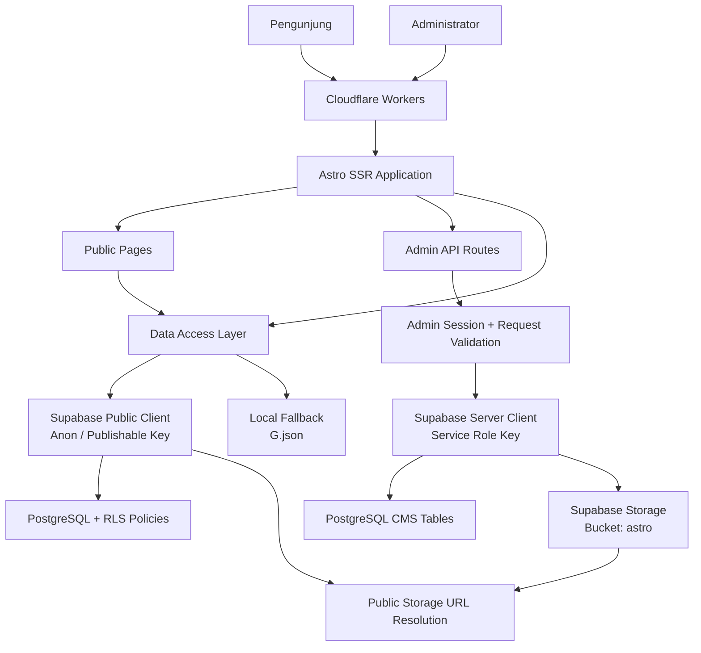
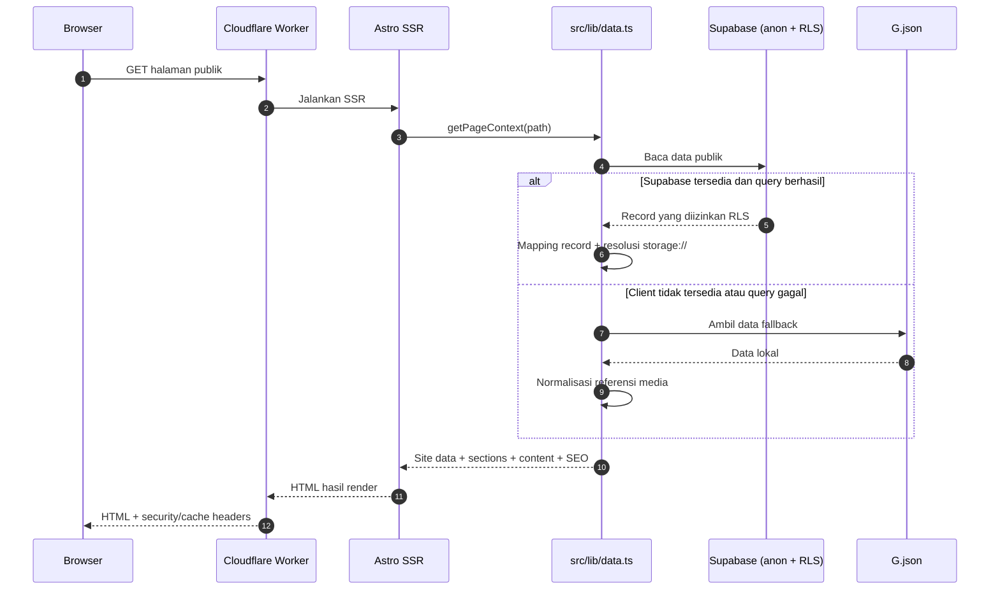
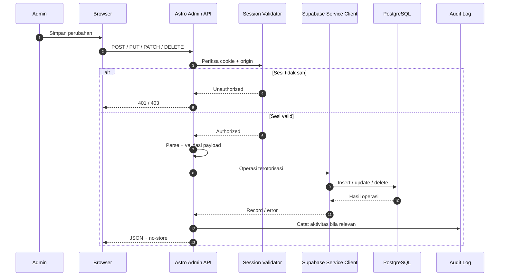

<div align="center">

# TKJ XII-9 — Website Kelas & Content Management System

**Website kelas Teknik Komputer dan Jaringan XII-9**  
SMK Muhammadiyah Belitang · Indonesia

<p>
  <a href="https://github.com/Pratama-Host/astro-web/actions/workflows/ci.yml"></a>
  <a href="https://github.com/Pratama-Host/astro-web"></a>
  <a href="https://github.com/Pratama-Host/astro-web"></a>
  <a href="https://github.com/Pratama-Host/astro-web"></a>
  <a href="https://github.com/Pratama-Host/astro-web"></a>
</p>

<p>
  <em>Ruang digital kelas yang menggabungkan dokumentasi, identitas, karya, informasi keahlian, dan pengelolaan konten dalam satu sistem.</em>
</p>

[Arsitektur](#-arsitektur-sistem) · [Fitur](#-fitur-utama) · [Instalasi](#-memulai-pengembangan) · [Deploy](#-deployment-cloudflare-workers) · [Database](#-database--supabase) · [Keamanan](#-keamanan) · [Troubleshooting](#-troubleshooting)

</div>

---

## Daftar Isi

- [Tentang Proyek](#-tentang-proyek)
- [Filosofi dan Tujuan](#-filosofi-dan-tujuan)
- [Fitur Utama](#-fitur-utama)
- [Galeri Modul](#-galeri-modul)
- [Arsitektur Sistem](#-arsitektur-sistem)
- [Alur Data](#-alur-data)
- [Teknologi](#-teknologi)
- [Struktur Repository](#-struktur-repository)
- [Rute Website](#-rute-website)
- [Content Management System](#-content-management-system-cms)
- [Database dan Supabase](#-database--supabase)
- [Media dan Supabase Storage](#-media--supabase-storage)
- [Environment Variables](#-environment-variables)
- [Memulai Pengembangan](#-memulai-pengembangan)
- [Perintah NPM](#-perintah-npm)
- [Deployment Cloudflare Workers](#-deployment-cloudflare-workers)
- [Migrasi Database](#-migrasi-database)
- [Backup dan Pemulihan](#-backup-dan-pemulihan)
- [Keamanan](#-keamanan)
- [PWA dan Pengalaman Offline](#-pwa-dan-pengalaman-offline)
- [Caching dan SEO](#-caching-dan-seo)
- [Pengujian dan CI](#-pengujian-dan-ci)
- [Operasional dan Pemeliharaan](#-operasional-dan-pemeliharaan)
- [Troubleshooting](#-troubleshooting)
- [Panduan Kontribusi](#-panduan-kontribusi)
- [Roadmap Teknis](#-roadmap-teknis)
- [Status Proyek](#-status-proyek)
- [Lisensi dan Kredit](#-lisensi-dan-kredit)

---

## ✦ Tentang Proyek

**TKJ XII-9 Website** adalah aplikasi web kelas yang dibangun untuk mendokumentasikan identitas, aktivitas, struktur organisasi, anggota, keahlian, dan perjalanan kelas Teknik Komputer dan Jaringan XII-9 di SMK Muhammadiyah Belitang.

Proyek ini bukan sekadar halaman profil statis. Website menggunakan **Astro dalam mode server-side rendering (SSR)**, **Supabase sebagai backend data dan media**, serta **Cloudflare Workers sebagai runtime deployment**. Pengelolaan konten disediakan melalui CMS internal sehingga konten utama dapat diperbarui tanpa harus mengedit file komponen secara manual.

Aplikasi dirancang dengan beberapa lapisan yang saling melengkapi:

| Lapisan | Tanggung jawab |
| --- | --- |
| Presentation | Halaman publik, komponen antarmuka, navigasi, interaksi, dan tampilan responsif. |
| Application | Pengambilan data, pemetaan record, validasi input, autentikasi admin, dan aturan CMS. |
| Data | PostgreSQL melalui Supabase, termasuk kebijakan Row Level Security (RLS). |
| Media | Supabase Storage untuk gambar, logo, audio, dan aset terkait. |
| Runtime | Astro SSR yang dijalankan di Cloudflare Workers. |
| Resilience | Data fallback lokal, cache terkontrol, halaman offline, dan service worker. |

> [!NOTE]
> Dokumentasi ini mengikuti struktur proyek pada paket `astro-web-main-v3` yang diperiksa pada **6 November 2026**. Nilai konfigurasi, jumlah data, dan detail deployment dapat berubah ketika repository berkembang. Selalu cocokkan dokumentasi ini dengan source code dan konfigurasi environment yang sedang digunakan.

## 🎯 Filosofi dan Tujuan

Website dikembangkan sebagai ruang dokumentasi sekaligus representasi pembelajaran vokasi. Arah utamanya:

- **Dokumentasi:** menyimpan cerita, profil, karya, aktivitas, dan perkembangan kelas.
- **Identitas:** menyediakan pusat informasi kelas yang konsisten dan mudah diakses.
- **Keterampilan:** menampilkan kompetensi yang berkaitan dengan Teknik Komputer dan Jaringan.
- **Kemandirian pengelolaan:** memberi pengelola akses untuk memperbarui konten melalui CMS.
- **Keberlanjutan:** memisahkan konten dari kode, menggunakan backup, dan menjaga konfigurasi agar dapat dipulihkan.

Prinsip implementasi yang diprioritaskan adalah keterbacaan kode, validasi input, pembatasan akses, pemisahan rahasia server, responsivitas antarmuka, serta fallback yang tidak menyamarkan kesalahan integrasi.

## 🚀 Fitur Utama

### Pengalaman publik

- Beranda dengan pengenalan kelas, statistik, informasi pengajar, dan bagian visi, misi, serta prestasi.
- Direktori anggota dengan profil dan informasi terkait.
- Struktur organisasi kelas.
- Galeri dokumentasi dan koleksi media.
- Halaman keahlian atau kompetensi.
- Halaman pengenalan Teknik Komputer dan Jaringan.
- Halaman pengembang dan dokumentasi perjalanan proyek.
- Pengaturan SEO per halaman, sitemap, dan robots endpoint.
- Tampilan yang menyesuaikan layar ponsel maupun desktop.

### CMS internal

- Login admin berbasis password dan session cookie bertanda tangan.
- Dashboard ringkasan konten dan aktivitas.
- Manajemen anggota.
- Manajemen galeri.
- Media library dan unggah berkas.
- Pengelolaan konten dan pengaturan situs.
- Pengaturan visibilitas serta urutan section halaman.
- Pengaturan navigasi.
- Pengelolaan koleksi data.
- Pengaturan SEO halaman.
- Draft halaman dan preview draft yang terotorisasi.
- Riwayat revisi konten.
- Audit aktivitas admin.
- Ekspor dan pemulihan backup CMS.

### Infrastruktur dan reliabilitas

- Astro SSR di Cloudflare Workers.
- Supabase PostgreSQL dan Supabase Storage.
- Public client menggunakan anon/publishable key dengan RLS.
- Server-side admin client menggunakan service-role key.
- Data fallback lokal dari `src/data/G.json`.
- Resolusi referensi media `storage://` menjadi public URL Storage.
- PWA manifest, service worker, dan halaman offline.
- Cache publik dengan TTL singkat dan jalur admin/API tanpa cache.
- Workflow GitHub Actions untuk pemeriksaan, tes, audit dependensi, dan build.

## 🧩 Galeri Modul

| Modul | Lokasi | Fungsi |
| --- | --- | --- |
| Beranda | `/` | Ringkasan identitas dan informasi utama kelas. |
| Anggota | `/anggota` | Direktori profil anggota. |
| Struktur | `/struktur` | Struktur organisasi dan pembagian peran. |
| Keahlian | `/keahlian` | Daftar kompetensi dan keterampilan. |
| Galeri | `/galeri` | Dokumentasi foto dan media kelas. |
| TKJ | `/tkj` | Informasi bidang Teknik Komputer dan Jaringan. |
| Pengembang | `/pengembang` | Profil pengembangan dan cerita proyek. |
| Admin CMS | `/pengembang/admin` | Panel pengelolaan website. |

---

## 🏗️ Arsitektur Sistem



### Komponen arsitektur

| Komponen | Implementasi | Catatan |
| --- | --- | --- |
| Web framework | Astro 7.4.5 | `output: 'server'`; halaman dirender pada runtime. |
| Adapter | `@astrojs/cloudflare` 14.4.4 | Menghubungkan output Astro ke Cloudflare Workers. |
| Runtime | Cloudflare Workers | Entry point ditentukan oleh `wrangler.json`. |
| Database | Supabase PostgreSQL | Menyimpan konten, konfigurasi, metadata media, revisi, dan audit. |
| Data SDK | `@supabase/supabase-js` 2.118.0 | Digunakan pada sisi server untuk akses database dan Storage. |
| Asset storage | Supabase Storage | Bucket default proyek: `astro`. |
| Authentication | HMAC-SHA256 session cookie | Validasi dilakukan pada server/API. |
| Test runner | Vitest 5.1.0 | Menjalankan unit test di folder `tests/`. |
| CI | GitHub Actions | Pipeline pada `.github/workflows/ci.yml`. |

### Keputusan arsitektur penting

1. **SSR, bukan static-only.** Aplikasi membutuhkan akses runtime ke Supabase, validasi sesi, dan API CMS.
2. **Kredensial dibagi berdasarkan hak akses.** Halaman publik menggunakan `SUPABASE_ANON_KEY`; operasi administratif menggunakan `SUPABASE_SERVICE_KEY` di server.
3. **RLS menjadi pagar data publik.** Anon key bukan pengganti policy database. Data yang boleh tampil tetap ditentukan oleh RLS.
4. **Konten terpisah dari komponen.** Data utama disimpan di Supabase, sedangkan `G.json` berfungsi sebagai fallback lokal dan sumber migrasi awal.
5. **Media memakai referensi stabil.** String `storage://...` diselesaikan oleh data layer menjadi URL Storage sesuai bucket yang dikonfigurasi.
6. **Jalur privat tidak boleh di-cache.** Admin, API admin, dan draft preview menggunakan header `no-store`.

## 🔄 Alur Data

### Pembacaan halaman publik



### Alur perubahan konten admin



### Fallback data

`src/lib/data.ts` menggunakan `src/data/G.json` sebagai fallback. Jika Supabase tidak tersedia atau query mengalami error, data layer dapat mengembalikan data fallback dan menuliskan penyebab kegagalan ke log server dengan prefix `[data:<scope>]`.

Fallback membantu menjaga sebagian halaman tetap memiliki konten dasar, tetapi **tidak berarti seluruh fitur CMS atau semua berkas media tetap tersedia**. Referensi `storage://` memerlukan client Supabase yang valid untuk dibentuk menjadi public URL.

---

## 🧰 Teknologi

### Runtime dan framework

| Paket | Versi pada repository | Kegunaan |
| --- | ---: | --- |
| `astro` | `7.4.5` | Framework utama dan SSR. |
| `@astrojs/cloudflare` | `14.4.4` | Adapter Cloudflare Workers. |
| `@supabase/supabase-js` | `2.118.0` | Client Supabase. |
| `typescript` | `5.9.3` | Bahasa dan pemeriksaan tipe. |
| `@astrojs/check` | `0.9.12` | Pemeriksaan Astro/TypeScript. |
| `vitest` | `5.1.0` | Unit testing. |
| `wrangler` | `4.156.1` | CLI Cloudflare Workers. |
| `@types/node` | `24.19.2` | Tipe Node.js. |

### Versi Node.js

- Versi yang diminta oleh `engines`: **Node.js `>=22.23.4`**.
- Versi yang dipatok pada `.nvmrc`: **`24.22.1`**.
- Package manager metadata: **npm `10.9.2`**.

Gunakan versi Node yang sesuai sebelum memasang dependency. Versi runtime lokal yang berbeda dapat menghasilkan dependency tree atau perilaku build yang berbeda.

---

## 📁 Struktur Repository

Struktur berikut menampilkan direktori dan file penting, bukan seluruh file aset visual.

```text
astro-web/
├── .github/
│   └── workflows/
│       └── ci.yml                 # CI: audit, check, test, build
├── docs/
│   └── AUDIT.md                   # Laporan audit database dan keamanan
├── supabase/
│   ├── config.toml                # Konfigurasi Supabase CLI
│   ├── migrations/                # Skema + policy (berstempel waktu, urut)
│   │   ├── 20261106000100_baseline.sql
│   │   ├── 20261106000200_home_section_controls.sql
│   │   ├── 20261106000300_public_read_only_rls.sql
│   │   ├── 20261106000400_gallery_metadata_from_caption.sql
│   │   └── 20261106000500_public_section_visibility_metadata.sql
│   ├── seed/                      # Hasil `npm run migrate:data` (ditinjau manual)
│   └── smoke/
│       └── cms-rpc-smoke.sql      # Smoke test RPC (rollback-only)
├── public/
│   ├── icons/                     # PWA icons
│   ├── audio-player.html
│   ├── offline.html
│   ├── manifest.json
│   ├── sw.js                      # Service worker
│   └── _headers                   # Header rules untuk static assets
├── scripts/
│   ├── migrate-data.mjs           # Generate seed SQL + media manifest
│   └── upload-media.mjs           # Upload berkas berdasarkan manifest
├── src/
│   ├── components/                # Komponen Astro yang dapat digunakan ulang
│   ├── data/
│   │   ├── G.json                 # Data fallback / sumber migrasi awal
│   │   ├── developer-defaults.ts
│   │   └── developer-legacy-stories.ts
│   ├── layouts/
│   │   ├── Layout.astro
│   │   └── DeveloperLayout.astro
│   ├── lib/
│   │   ├── admin-auth.ts          # Session, password, origin validation
│   │   ├── cms-admin.ts           # Sanitasi dan validasi payload CMS
│   │   ├── data.ts                # Data access, mapping, fallback
│   │   ├── media-validation.ts    # Validasi media
│   │   ├── site-url.ts            # URL/canonical helpers
│   │   └── supabase.ts            # Public/admin Supabase clients
│   ├── pages/
│   │   ├── api/
│   │   │   ├── admin/             # Endpoint privat CMS
│   │   │   └── public/             # Endpoint publik terbatas
│   │   ├── pengembang/
│   │   │   └── admin.astro        # CMS dashboard
│   │   ├── index.astro
│   │   ├── anggota.astro
│   │   ├── galeri.astro
│   │   ├── struktur.astro
│   │   ├── keahlian.astro
│   │   ├── tkj.astro
│   │   ├── pengembang.astro
│   │   ├── sitemap.xml.ts
│   │   ├── robots.txt.ts
│   │   ├── offline.astro
│   │   └── 404.astro
│   ├── scripts/                   # Interaksi client-side
│   │   ├── admin.js               # Entry panel admin (memuat modul di admin/)
│   │   └── admin/                 # Modul admin per fitur (core, shell, members, gallery, ...)
│   ├── styles/                    # Stylesheet per halaman/komponen
│   ├── env.d.ts
│   └── middleware.ts              # Security headers + cache policy
├── tests/
│   ├── admin-auth.test.ts
│   ├── cms-admin.test.ts
│   ├── cms-admin-helpers.test.ts
│   ├── data-mappers.test.ts
│   └── media-validation.test.ts
├── .editorconfig
├── .env.example
├── .gitattributes
├── .gitignore
├── .nvmrc
├── astro.config.mjs
├── package.json
├── vitest.config.ts
├── wrangler.json
└── README.md
```

### Batas tanggung jawab direktori

- `src/pages/`: routing dan komposisi halaman.
- `src/components/`: komponen UI yang digunakan lintas halaman.
- `src/layouts/`: kerangka halaman dan metadata global.
- `src/scripts/`: perilaku browser, interaksi, dan enhancement antarmuka. Panel admin dipecah per fitur di `src/scripts/admin/`; `admin.js` hanya entry point.
- `src/styles/`: gaya visual global dan spesifik halaman.
- `src/lib/`: aturan aplikasi, akses data, autentikasi, validasi, dan helper.
- `src/data/`: data fallback dan konfigurasi konten lokal.
- `supabase/migrations/`: perubahan skema, policy, serta baseline database (nama berstempel waktu, sesuai Supabase CLI).
- `supabase/seed/`: keluaran `npm run migrate:data` (seed SQL dan manifest media), sengaja di luar `migrations/` agar tidak ikut dijalankan otomatis.
- `scripts/`: utilitas migrasi data dan upload berkas.
- `tests/`: unit test Vitest. Smoke test SQL ada di `supabase/smoke/cms-rpc-smoke.sql`.

---

## 🌐 Rute Website

| Path | Jenis | Deskripsi |
| --- | --- | --- |
| `/` | Publik | Beranda kelas. |
| `/anggota` | Publik | Daftar anggota dan profil. |
| `/struktur` | Publik | Struktur organisasi kelas. |
| `/keahlian` | Publik | Kompetensi dan daftar keterampilan. |
| `/galeri` | Publik | Galeri dokumentasi. |
| `/tkj` | Publik | Informasi jurusan TKJ. |
| `/pengembang` | Publik | Profil pengembang dan catatan proyek. |
| `/pengembang/admin` | Privat | Panel administrator CMS. |
| `/offline` | Sistem | Halaman cadangan saat tidak terhubung. |
| `/404` | Sistem | Halaman tidak ditemukan. |
| `/sitemap.xml` | SEO | Sitemap dinamis. |
| `/robots.txt` | SEO | Instruksi crawler. |

### API routes

#### Endpoint publik

| Endpoint | Method | Kegunaan |
| --- | --- | --- |
| `/api/public/settings` | `GET` | Menyediakan subset pengaturan media publik. |

#### Endpoint admin

Semua endpoint berikut berada di bawah `/api/admin/` dan diperiksa menggunakan sesi admin sebelum operasi dilakukan.

| Endpoint | Method utama | Fungsi |
| --- | --- | --- |
| `/api/admin/login` | `POST` | Memvalidasi password dan membuat sesi. |
| `/api/admin/logout` | `POST` | Mengakhiri sesi admin. |
| `/api/admin/cms` | `GET` | Ringkasan data dan status CMS. |
| `/api/admin/anggota` | `GET`, `POST`, `PUT`, `DELETE` | CRUD anggota. |
| `/api/admin/gallery` | `GET`, `PUT`, `DELETE` | Membaca, memperbarui, dan menghapus record galeri. |
| `/api/admin/media` | `GET`, `POST`, `PATCH`, `DELETE` | Media library dan operasi Storage terkait. |
| `/api/admin/content` | `GET`, `PUT` | Pengaturan dan konten situs. |
| `/api/admin/collections` | `GET`, `PUT` | Pengelolaan koleksi. |
| `/api/admin/navigation` | `GET`, `PUT` | Pengaturan navigasi. |
| `/api/admin/sections` | `GET`, `PUT` | Urutan dan visibilitas section halaman. |
| `/api/admin/pages` | `GET`, `PUT` | Konten halaman terpublikasi. |
| `/api/admin/drafts` | `GET`, `PUT`, `POST` | Draft, penyimpanan, dan penghapusan draft. |
| `/api/admin/revisions` | `GET`, `POST` | Riwayat versi konten. |
| `/api/admin/audit` | `GET` | Riwayat aktivitas admin. |
| `/api/admin/backup` | `GET`, `POST` | Ekspor dan pemulihan backup CMS. |

> [!IMPORTANT]
> Daftar method di atas adalah ringkasan berdasarkan handler pada source. Bentuk payload, parameter, dan aturan validasi tetap mengikuti implementasi setiap endpoint. Jangan mengirim request mutasi langsung tanpa memahami skema payload-nya.

---

## 🖥️ Content Management System (CMS)

Panel CMS berada di **`/pengembang/admin`**. Halaman `/pengembang` adalah halaman publik; keduanya memiliki fungsi yang berbeda.

### Modul dashboard

Panel admin mendefinisikan tampilan berikut:

| View | Kegunaan |
| --- | --- |
| Dashboard | Ringkasan jumlah data dan aktivitas terakhir. |
| Members | Data anggota, profil, foto, audio, skill, urutan, dan visibilitas. |
| Gallery | Record koleksi foto dan metadata galeri. |
| Media | Library media, metadata, dan unggah aset. |
| Content | Pengaturan konten utama website. |
| Sections | Toggle tampil/sembunyi dan urutan section. |
| Navigation | Label, URL internal, ikon, urutan, dan status navigasi. |
| Collections | Pengelolaan kelompok data yang didukung CMS. |
| SEO | Judul, deskripsi, OG image, dan opsi indeksasi halaman. |
| Appearance | Pengaturan tampilan yang tersedia di CMS. |
| System | Informasi sistem dan utilitas pengelolaan/backup. |

### Mekanisme penyimpanan konten

- Pengaturan global website disimpan pada `site_settings` dengan key utama `site`.
- Data anggota disimpan pada `anggota`.
- Data galeri disimpan pada `galeri`.
- Data pengajar disimpan pada `guru`.
- Data kompetensi disimpan pada `skills`.
- Pengaturan navigasi disimpan pada `site_navigation`.
- Pengaturan section disimpan pada `site_sections`.
- Konten halaman disimpan pada `site_pages`.
- Draft halaman disimpan terpisah pada `site_page_drafts`.
- Revisi dan aktivitas admin disimpan pada tabel internal masing-masing.

### Draft dan preview

Preview draft menggunakan parameter `previewDraft=1` dan memerlukan sesi admin yang valid. Draft preview tidak boleh dibagikan sebagai URL publik dan responsnya diberi kebijakan `no-store` serta `noindex`.

### Praktik penggunaan CMS

1. Login dari alamat `/pengembang/admin`.
2. Periksa dashboard sebelum mengubah konten.
3. Ubah hanya data yang dibutuhkan.
4. Gunakan tombol simpan dan periksa pesan hasil operasi.
5. Buka halaman publik terkait untuk memvalidasi hasil.
6. Jika perubahan tidak terlihat, pertimbangkan cache browser/edge sebelum mengulang perubahan yang sama.
7. Ekspor backup sebelum perubahan besar atau perubahan yang menyentuh banyak record.

---

## 🗄️ Database & Supabase

Supabase digunakan sebagai backend utama untuk data terstruktur dan media.

### Tabel domain utama

| Tabel | Peran |
| --- | --- |
| `site_settings` | Pengaturan global dan konfigurasi media situs. |
| `anggota` | Data identitas, deskripsi, sosial, foto, audio, dan visibilitas anggota. |
| `galeri` | Metadata dan referensi aset galeri. |
| `guru` | Informasi pengajar, mata pelajaran, peran, dan keahlian. |
| `skills` | Daftar kompetensi dan tingkat keterampilan. |
| `site_navigation` | Item navigasi situs. |
| `site_sections` | Pengaturan section per halaman, termasuk urutan dan status tampil. |
| `site_pages` | Konten halaman yang dipublikasikan dan metadata SEO. |
| `site_page_drafts` | Draft konten halaman yang belum dipublikasikan. |
| `media_assets` | Metadata object media dan informasi terkait. |
| `content_revisions` | Riwayat revisi konten. |
| `admin_audit_logs` | Catatan aktivitas administratif. |
| `admin_login_attempts` | Data pembatasan percobaan login. |

### Pemisahan client Supabase

Implementasi berada di `src/lib/supabase.ts`.

| Client | Environment key | Penggunaan | Boleh di browser? |
| --- | --- | --- | --- |
| Public client | `SUPABASE_ANON_KEY` | Pembacaan data publik yang dibatasi RLS. | Anon/publishable key memang dirancang untuk konteks publik, tetapi tetap harus dilindungi RLS. |
| Admin client | `SUPABASE_SERVICE_KEY` | API admin, preview draft terotorisasi, dan operasi server yang membutuhkan hak istimewa. | **Tidak. Rahasia server-only.** |

Kedua client menggunakan `persistSession: false`, `autoRefreshToken: false`, dan `detectSessionInUrl: false`.

### Model akses publik

RLS aktif pada tabel yang diaudit. Policy publik mengatur tabel mana yang boleh dibaca oleh role `anon` dan `authenticated`, serta record mana yang terlihat. Secara umum:

- Data anggota dan galeri mengikuti status `visible`.
- Pengaturan situs dibatasi pada record konfigurasi publik.
- Data pengajar dan keterampilan memiliki policy baca publik.
- Metadata section perlu dapat dibaca meskipun `enabled=false`, agar halaman publik mengetahui section yang harus disembunyikan.
- Tabel internal seperti draft, revisi, audit, dan percobaan login tidak dibuka untuk pembacaan publik.

Rincian policy final harus dilihat pada `supabase/migrations/20261106000100_baseline.sql` dan `supabase/migrations/20261106000300_public_read_only_rls.sql` sampai `supabase/migrations/20261106000500_public_section_visibility_metadata.sql`.

> [!WARNING]
> Jangan menyelesaikan masalah `permission denied` dengan memberi akses publik secara menyeluruh. Periksa tabel, operasi, role, dan kolom yang benar-benar diperlukan. Jangan membuat policy `USING (true)` pada tabel yang mengandung draft, audit, login, atau metadata internal tanpa analisis risiko.

### Data fallback

`src/data/G.json` menyimpan data lokal untuk fallback dan migrasi awal. File ini bukan pengganti database produksi dan tidak otomatis menyinkronkan perubahan yang dilakukan melalui CMS.

---

## 🖼️ Media & Supabase Storage

Bucket Storage default pada proyek adalah **`astro`**. Nama bucket dapat diganti melalui `SUPABASE_STORAGE_BUCKET`.

### Format referensi media

Data dapat menyimpan referensi seperti:

```text
storage://anggota/nama-file.webp
storage://galeri/dokumentasi-kegiatan.jpg
storage://assets-global/logo/logo-utama.svg
storage://assets-global/audio/audio-kelas.weba
```

Bagian setelah `storage://` adalah object path pada bucket yang dikonfigurasi. Data layer menggunakan `getPublicUrl()` untuk menyusun URL publik.

### Area penyimpanan yang digunakan

| Prefix object path | Tujuan umum |
| --- | --- |
| `anggota/` | Foto profil anggota. |
| `galeri/` | Foto dokumentasi dan galeri. |
| `assets-global/logo/` | Logo dan identitas visual global. |
| `assets-global/audio/` | Audio global. |
| `assets-global/` | Aset global lain yang sesuai. |
| `_thumbnails/` | Thumbnail turunan yang dikelola media system. |

### Proses upload

Upload melalui CMS menggunakan endpoint admin dan server-side service client. Script `scripts/upload-media.mjs` juga tersedia untuk upload batch berdasarkan manifest.

```bash
npm run migrate:data
npm run media:upload
```

Script migrasi menghasilkan:

- `supabase/seed/seed.generated.sql`
- `supabase/seed/media-manifest.json`

`migrate-data.mjs` **hanya menghasilkan file**, tidak menghubungkan diri ke Supabase, tidak menjalankan SQL, dan tidak mengunggah berkas. `upload-media.mjs` baru melakukan upload dan membutuhkan kredensial server serta manifest yang valid.

### Perhatian media

- Pastikan object path sesuai dengan referensi yang disimpan di database.
- Pastikan bucket dan kebijakan Storage sesuai rancangan akses.
- Jangan menghapus object hanya karena record CMS diubah sebelum memeriksa apakah object tersebut masih digunakan di tempat lain.
- Jangan mengunggah file `.env`, backup berisi data pribadi, atau dokumen internal ke bucket publik.
- Periksa MIME type, ukuran berkas, serta validasi konten file sebelum upload.

---

## 🔐 Environment Variables

Salin `.env.example` menjadi `.env` untuk pengembangan lokal. Untuk Cloudflare Workers, atur variable pada **Workers & Pages → Worker → Settings → Variables and Secrets**.

| Variable | Wajib | Sifat | Default / aturan | Keterangan |
| --- | :---: | --- | --- | --- |
| `SUPABASE_URL` | Ya | URL konfigurasi | Tidak ada | URL project Supabase yang digunakan aplikasi. |
| `SUPABASE_ANON_KEY` | Ya untuk data publik live | Publishable/anon key | Tidak ada | Digunakan public client untuk query yang dibatasi RLS. |
| `SUPABASE_SERVICE_KEY` | Ya untuk CMS/admin | **Secret** | Tidak ada | Service-role key. Hanya untuk server-side operations. |
| `SUPABASE_STORAGE_BUCKET` | Tidak | Konfigurasi | `astro` | Nama bucket Supabase Storage. |
| `ADMIN_PASSWORD` | Ya untuk login admin | **Secret** | Tidak ada | Password administrator. |
| `ADMIN_SESSION_SECRET` | Ya untuk sesi admin | **Secret** | Minimal 32 byte | Kunci HMAC untuk menandatangani sesi. |
| `SITE_ORIGIN` | Opsional | URL konfigurasi | Host request saat tidak diset | Origin kanonik untuk metadata situs. Harus berupa URL `http://` atau `https://` yang valid tanpa kredensial. |

### Contoh `.env` lokal

```dotenv
SUPABASE_URL=https://YOUR_PROJECT.supabase.co
SUPABASE_ANON_KEY=YOUR_SUPABASE_PUBLISHABLE_OR_ANON_KEY
SUPABASE_SERVICE_KEY=YOUR_SUPABASE_SERVICE_ROLE_KEY
SUPABASE_STORAGE_BUCKET=astro
ADMIN_PASSWORD=CHANGE_THIS_TO_A_LONG_UNIQUE_PASSWORD
ADMIN_SESSION_SECRET=REPLACE_WITH_A_RANDOM_SECRET_AT_LEAST_32_BYTES
SITE_ORIGIN=https://your-domain.example
```

Nilai di atas adalah placeholder, bukan kredensial yang dapat digunakan.

### Menghasilkan session secret

Gunakan generator kriptografis pada lingkungan lokal:

```bash
openssl rand -base64 48
```

Simpan hasilnya pada secret manager. Jangan memasukkan secret ke Git, screenshot, issue publik, atau README.

### Cloudflare: variable vs secret

Contoh pemisahan yang disarankan:

| Jenis | Variable |
| --- | --- |
| Plain variable | `SUPABASE_URL`, `SUPABASE_STORAGE_BUCKET`, `SITE_ORIGIN` |
| Secret | `SUPABASE_SERVICE_KEY`, `ADMIN_PASSWORD`, `ADMIN_SESSION_SECRET` |
| Public/publishable key | `SUPABASE_ANON_KEY` dapat disimpan sebagai variable atau secret di dashboard; kunci ini tetap harus dipasangkan dengan RLS yang benar. |

Contoh CLI untuk memasukkan secret:

```bash
npx wrangler secret put SUPABASE_SERVICE_KEY
npx wrangler secret put ADMIN_PASSWORD
npx wrangler secret put ADMIN_SESSION_SECRET
```

> [!CAUTION]
> **Jangan pernah memakai `SUPABASE_SERVICE_KEY` sebagai `SUPABASE_ANON_KEY`.** Jangan menamai service-role key dengan awalan `PUBLIC_`, jangan menyisipkannya ke JavaScript browser, dan jangan commit `.env`.

---

## 💻 Memulai Pengembangan

### Prasyarat

- Git.
- Node.js `>=22.23.4`; versi repository yang dipatok adalah `24.22.1`.
- npm.
- Project Supabase jika ingin menguji alur database dan CMS secara penuh.
- Akun Cloudflare hanya diperlukan untuk deployment.

### 1. Clone repository

```bash
git clone https://github.com/Pratama-Host/astro-web.git
cd astro-web
```

### 2. Gunakan versi Node yang sesuai

Dengan nvm:

```bash
nvm install
nvm use
node --version
npm --version
```

Pastikan Node memenuhi `engines` di `package.json`.

### 3. Pasang dependency

```bash
npm install
```

### 4. Siapkan environment lokal

```bash
cp .env.example .env
```

Isi `.env` dengan kredensial project pengembangan. Jangan menggunakan database produksi untuk eksperimen yang berpotensi mengubah data.

### 5. Jalankan development server

```bash
npm run dev
```

Buka URL lokal yang ditampilkan Astro pada terminal, biasanya `http://localhost:4321`.

### 6. Jalankan pemeriksaan

```bash
npm run check
npm test
npm run build
```

Untuk menjalankan seluruh tahap validasi sekaligus:

```bash
npm run validate
```

### Catatan pengembangan

- Hindari menguji perubahan destructive langsung ke database produksi.
- Gunakan branch kerja sebelum perubahan lintas modul.
- Jangan mengedit file generated output pada `dist/` sebagai sumber utama.
- Perubahan schema harus disertai migration dan pembaruan dokumentasi.
- Perubahan API harus mempertahankan validasi input, autentikasi, dan kebijakan no-store.
- Setelah perubahan UI, uji setidaknya satu viewport ponsel dan satu viewport desktop.

---

## 📦 Perintah NPM

| Perintah | Implementasi | Kegunaan |
| --- | --- | --- |
| `npm run dev` | `astro dev` | Menjalankan development server. |
| `npm start` | `astro dev` | Alias development server. |
| `npm run build` | `astro build` | Membuat output production pada `dist/`. |
| `npm run preview` | `astro preview` | Preview hasil build secara lokal. |
| `npm run astro` | `astro` | Memanggil Astro CLI. |
| `npm run check` | `astro check` | Pemeriksaan Astro dan TypeScript. |
| `npm test` | `vitest run` | Menjalankan unit test satu kali. |
| `npm run test:watch` | `vitest` | Menjalankan test dalam mode watch. |
| `npm run validate` | check + test + build | Validasi gabungan sebelum rilis. |
| `npm run deploy` | `wrangler deploy` | Deploy Worker. |
| `npm run migrate:data` | `node scripts/migrate-data.mjs` | Membuat seed SQL dan media manifest. |
| `npm run media:upload` | `node --env-file=.env scripts/upload-media.mjs` | Upload berkas dari manifest. |

---

## ☁️ Deployment Cloudflare Workers

Aplikasi dikonfigurasi sebagai Astro SSR Worker. Berkas utama konfigurasi deployment adalah:

- `astro.config.mjs`
- `wrangler.json`
- `.nvmrc`
- `.github/workflows/ci.yml`

### Konfigurasi runtime

Ringkasan `wrangler.json` saat dokumentasi ini dibuat:

| Properti | Nilai |
| --- | --- |
| Worker name | `astro-web` |
| Main entry | `@astrojs/cloudflare/entrypoints/server` |
| Compatibility date | `2026-11-03` |
| Compatibility flag | `nodejs_compat` |
| Static assets binding | `ASSETS` |
| Static assets directory | `./dist` |
| Observability | Enabled |
| Workers Cache | Enabled |
| Source maps upload | Enabled |

Astro dikonfigurasi dengan `output: 'server'`, adapter Cloudflare, `imageService: 'compile'`, dan kompresi HTML.

### Langkah deployment

1. Pastikan source code sudah berada di branch yang akan dirilis.
2. Pastikan variable dan secret Cloudflare sudah tersedia.
3. Pastikan `SUPABASE_URL` dan `SUPABASE_ANON_KEY` menunjuk project Supabase yang benar.
4. Pastikan `SUPABASE_SERVICE_KEY`, `ADMIN_PASSWORD`, dan `ADMIN_SESSION_SECRET` tersimpan sebagai secret.
5. Jalankan validasi lokal:

   ```bash
   npm run validate
   ```

6. Deploy:

   ```bash
   npm run deploy
   ```

7. Tunggu status deployment selesai pada Cloudflare Dashboard atau output Wrangler.
8. Lakukan smoke test publik dan admin setelah deployment.

### Smoke test setelah deploy

- [ ] Beranda dapat dibuka.
- [ ] Navigasi desktop dan menu ponsel berfungsi.
- [ ] Halaman anggota menampilkan data dan foto.
- [ ] Halaman galeri menampilkan media.
- [ ] Logo dan identitas visual tampil.
- [ ] Audio yang tersedia dapat diakses sesuai kontrol halaman.
- [ ] Struktur dan keahlian menampilkan konten.
- [ ] Halaman `/tkj` dapat dibuka.
- [ ] Halaman `/pengembang` dapat dibuka.
- [ ] Admin dapat login dan logout.
- [ ] Perubahan CMS tersimpan dan tetap ada setelah refresh.
- [ ] API admin tidak di-cache.
- [ ] Tidak ada error merah yang belum dijelaskan di Cloudflare atau Supabase Logs.

### Strategi rollback

Jika deployment baru menimbulkan regresi:

1. Hentikan perubahan lanjutan.
2. Identifikasi deployment terakhir yang diketahui sehat.
3. Gunakan mekanisme rollback/previous deployment Cloudflare yang tersedia.
4. Jangan melakukan rollback database secara otomatis hanya karena kode di-rollback.
5. Cocokkan versi kode, schema, dan environment variables sebelum mengaktifkan kembali trafik.
6. Verifikasi ulang halaman publik, CMS, media, dan log.

> [!IMPORTANT]
> Rollback kode tidak selalu membatalkan perubahan database. Migration database harus kompatibel dengan versi kode yang sedang digunakan atau memiliki prosedur pemulihan tersendiri.

---

## 🧱 Migrasi Database

Semua file migrasi SQL berada di `supabase/migrations/`; seed dan manifest hasil generate berada di `supabase/seed/`.

| File | Tujuan | Catatan |
| --- | --- | --- |
| `supabase/migrations/20261106000100_baseline.sql` | Baseline skema, index, constraint, RLS, routine/RPC, dan konfigurasi Storage yang direkonstruksi dari database aktif. | Untuk menyiapkan project baru; jangan dijalankan sembarangan pada database produksi yang sudah berisi data. |
| `supabase/migrations/20261106000200_home_section_controls.sql` | Menambahkan kontrol section beranda: hero, stats, teachers, about. | Aditif dan memakai `ON CONFLICT DO NOTHING`. |
| `supabase/migrations/20261106000300_public_read_only_rls.sql` | Policy pembacaan publik untuk data yang memang ditampilkan. | Tidak membuat policy mutasi publik. |
| `supabase/migrations/20261106000400_gallery_metadata_from_caption.sql` | Mengisi title dan alt text galeri yang kosong dari caption. | Mempertahankan nilai yang sudah ada. |
| `supabase/migrations/20261106000500_public_section_visibility_metadata.sql` | Mengizinkan pembacaan metadata visibilitas section. | Dibutuhkan agar halaman publik mengetahui status section `enabled=false`. |

### Aturan migrasi

1. Backup database sebelum perubahan schema atau data yang besar.
2. Baca seluruh isi migration sebelum menjalankannya.
3. Pastikan target Supabase project benar.
4. Jalankan migration sesuai urutan dan catat hasilnya.
5. Periksa policy, index, constraint, function, dan privilege setelah migrasi.
6. Uji akses anon dan admin secara terpisah.
7. Jangan menjalankan baseline pada database aktif hanya untuk “menyamakan” schema.

### Menyiapkan project Supabase baru

Alur tingkat tinggi untuk instalasi baru:

1. Buat project Supabase baru.
2. Tinjau `supabase/migrations/20261106000100_baseline.sql` dan terapkan pada project kosong yang memang disiapkan untuk repository ini.
3. Terapkan `0002` sampai `0005` secara berurutan.
4. Siapkan environment variables untuk aplikasi.
5. Buat data awal dari `G.json` bila memang diperlukan.
6. Generate seed dan media manifest:

   ```bash
   npm run migrate:data
   ```

7. Tinjau `supabase/seed/seed.generated.sql` sebelum menjalankannya melalui SQL Editor.
8. Siapkan object Storage berdasarkan `supabase/seed/media-manifest.json`.
9. Jalankan upload media bila sumber berkas tersedia:

   ```bash
   npm run media:upload
   ```

10. Deploy aplikasi dan lakukan smoke test.

> [!WARNING]
> `supabase/migrations/20261106000100_baseline.sql` direkonstruksi dari introspeksi database live. Walaupun file ditulis dengan guard tertentu, baseline ini belum boleh dianggap sebagai jaminan migrasi universal untuk setiap project Supabase. Uji lebih dahulu pada project disposable sebelum digunakan untuk provisioning baru. Pada database produksi yang saat ini sudah berjalan, jangan mengulang baseline.

---

## 💾 Backup dan Pemulihan

Backup adalah bagian dari operasional, bukan pekerjaan yang dilakukan hanya ketika sistem mulai bermasalah.

### Lapisan backup yang disarankan

Gunakan pendekatan 3-2-1 sebagai pedoman operasional:

- **Salinan 1 — cloud:** simpan salinan terenkripsi pada layanan cloud yang terpisah dari akun/runtime deployment.
- **Salinan 2 — media eksternal:** simpan salinan di SD card atau media eksternal.
- **Salinan 3 — lokal:** simpan salinan kerja pada perangkat yang digunakan untuk pemeliharaan.

Tiga lokasi tersebut harus berisi salinan yang dapat diverifikasi, bukan sekadar tiga shortcut menuju file yang sama.

### Apa yang dicakup oleh backup CMS

Endpoint `/api/admin/backup` menggunakan RPC database untuk ekspor dan pemulihan data CMS.

Data database yang tercakup meliputi pengaturan situs, anggota, galeri, guru, skills, halaman, draft, navigasi, sections, metadata media, revisi, dan audit log. Endpoint membatasi ukuran payload backup sampai **20 MB**.

**Backup CMS tidak sama dengan backup seluruh berkas biner di Supabase Storage.** Foto, audio, logo, thumbnail, dan object lain yang tersimpan di bucket perlu dicadangkan melalui prosedur Storage tersendiri.

### Checklist backup

- [ ] Ekspor database/CMS berhasil.
- [ ] File JSON dapat dibuka dan strukturnya valid.
- [ ] Source code repository sudah di-commit atau diarsipkan.
- [ ] Berkas Storage dicadangkan terpisah.
- [ ] Environment variable dicatat pada password manager/secret manager, bukan pada README.
- [ ] Tanggal, versi source, dan project tujuan dicatat.
- [ ] Checksum file dibuat untuk mendeteksi perubahan atau kerusakan.
- [ ] Minimal satu salinan berada di luar perangkat utama.
- [ ] Restore test pernah dilakukan pada lingkungan terpisah.

### Pemulihan data

1. Pastikan project tujuan benar dan tersedia.
2. Pastikan schema serta RPC yang diperlukan sudah ada.
3. Siapkan backup database yang telah diverifikasi.
4. Gunakan fungsi restore melalui panel CMS/API yang terotorisasi atau prosedur SQL terverifikasi.
5. Pulihkan object Storage secara terpisah.
6. Cocokkan kembali object path di database dengan berkas yang benar-benar tersedia.
7. Uji halaman publik dan seluruh jenis media.
8. Uji login admin, operasi simpan, dan log.

### Uji restore lebih penting daripada sekadar file backup

Backup yang belum pernah diuji restore masih menyimpan ketidakpastian. Jadwalkan pengujian pada project staging/disposable agar proses pemulihan tidak membahayakan data aktif.

---

## 🛡️ Keamanan

Keamanan aplikasi dibangun dari beberapa lapisan. Tidak ada satu kontrol yang menggantikan kontrol lainnya.

### Autentikasi admin

Implementasi berada di `src/lib/admin-auth.ts` dan endpoint login.

| Mekanisme | Implementasi |
| --- | --- |
| Password | Dibandingkan dengan pemeriksaan constant-time (`timingSafeEqual`). |
| Session signature | HMAC-SHA256. |
| Cookie name | `tkj_admin_session`. |
| Cookie flags | `HttpOnly`, `SameSite=Strict`, `Path=/`, dan `Secure` pada production. |
| Session lifetime | 8 jam. |
| Session secret | Minimal 32 byte. |
| Login rate limit | Maksimum 5 percobaan per IP hash dalam 300 detik, melalui RPC database. |
| Origin validation | Mutasi admin harus berasal dari origin yang sama. |
| Response caching | Admin dan API admin menggunakan `no-store`. |

IP address di-hash menggunakan HMAC sebelum digunakan sebagai identitas rate-limit pada database. Login juga membutuhkan header IP Cloudflare di production.

### Validasi input CMS

`src/lib/cms-admin.ts` menyediakan helper untuk:

- membaca request body dengan batas ukuran;
- memastikan JSON berbentuk record yang diharapkan;
- membersihkan teks dan membatasi panjang;
- memvalidasi URL publik;
- memvalidasi referensi media;
- memeriksa tautan sosial;
- memvalidasi URL internal;
- memvalidasi warna hex.

Validasi harus tetap dilakukan pada server walaupun UI sudah membatasi input. Validasi di browser bukan batas keamanan.

### Keamanan media

Media upload memiliki pemeriksaan tipe/signature dan pembatasan pada beberapa jalur unggah. Test media mencakup signature PNG, thumbnail WebP, mismatch tipe, dan penolakan SVG aktif. Jangan mengasumsikan bahwa ekstensi file saja cukup untuk menyatakan file aman.

### HTTP security headers

`src/middleware.ts` dan `public/_headers` menetapkan sejumlah header, antara lain:

- `X-Content-Type-Options: nosniff`
- `Referrer-Policy: strict-origin-when-cross-origin`
- `Permissions-Policy`
- `X-Frame-Options: SAMEORIGIN` pada respons yang melalui middleware
- `Content-Security-Policy`

Konfigurasi CSP saat ini mengizinkan beberapa sumber eksternal yang dipakai proyek. Saat menambah CDN, font, analytics, atau integrasi eksternal, perbarui CSP secara terukur dan tinjau dampaknya.

### Aturan keamanan wajib

- Jangan commit `.env`.
- Jangan menaruh service-role key di frontend.
- Jangan membuka tabel privat ke role `anon`.
- Jangan membuat policy tulis publik untuk CMS.
- Jangan menghapus RLS untuk mengatasi error.
- Jangan menonaktifkan validasi upload hanya agar file dapat masuk.
- Jangan menampilkan detail error internal, token, atau kredensial kepada pengunjung.
- Lakukan review terhadap perubahan dependency dan jalankan `npm audit`.

---

## 📱 PWA dan Pengalaman Offline

Repository menyertakan:

- `public/manifest.json`
- `public/sw.js`
- `public/offline.html`
- ikon PWA pada `public/icons/`

### Strategi caching service worker

Service worker saat ini menggunakan strategi yang berbeda berdasarkan jenis request:

| Jenis request | Strategi |
| --- | --- |
| Navigasi HTML | Network-first, fallback ke cache atau `/offline`. |
| Aset `/_astro/` | Cache-first, kemudian mengambil dari network bila belum ada. |
| Admin `/pengembang/admin` | Tidak diintersep oleh service worker. |
| `/api/*` | Tidak diintersep oleh service worker. |
| Draft preview | Network-only dengan `no-store`. |
| Request non-GET | Tidak diintersep. |

Cache statis dibatasi hingga **120 entry**. Ketika service worker baru diaktifkan, cache lama dengan nama berbeda akan dibersihkan.

> [!IMPORTANT]
> Service worker dapat membuat browser masih menampilkan versi lama untuk aset atau halaman publik. Setelah perubahan besar pada frontend, lakukan pengujian pada browser bersih dan pastikan update service worker telah diterapkan. Jalur admin dan API sengaja dikecualikan agar data sensitif tidak masuk cache offline.

---

## 🔎 Caching dan SEO

### Edge cache

Middleware mengatur header berdasarkan jenis respons:

- Halaman HTML publik yang berhasil: `s-maxage=60` dan `stale-while-revalidate=600`.
- Admin route dan draft preview: `private, no-store` serta header no-store khusus CDN.
- API non-publik: `private, no-store`.
- API settings publik: memiliki cache pendek pada handler tersendiri.

Dengan kebijakan ini, konten publik dapat disajikan lebih efisien tanpa menyimpan halaman admin atau draft preview pada cache bersama.

### SEO

Fitur SEO yang tersedia dalam repository:

- `SITE_ORIGIN` untuk origin kanonik bila diperlukan.
- Helper URL pada `src/lib/site-url.ts`.
- Metadata SEO halaman dari `site_pages`.
- Metadata draft hanya pada preview admin yang sah.
- `src/pages/sitemap.xml.ts`.
- `src/pages/robots.txt.ts`.
- Meta `noindex` pada admin dan draft preview.
- OG image melalui referensi media yang dapat diselesaikan oleh data layer.

Jika mengganti domain, periksa `SITE_ORIGIN`, DNS, domain Worker, sitemap, robots, dan metadata canonical/OG.

---

## 🧪 Pengujian dan CI

### Unit test

Folder `tests/` memuat pengujian untuk area berikut:

| File | Fokus |
| --- | --- |
| `admin-auth.test.ts` | Autentikasi dan validasi sesi admin. |
| `cms-admin.test.ts` | Helper dan validasi CMS. |
| `cms-admin-helpers.test.ts` | Sanitasi teks, record, dan batas request. |
| `data-mappers.test.ts` | Pemetaan data anggota/galeri dan resolusi media. |
| `media-validation.test.ts` | Pemeriksaan signature dan validasi media. |

Jalankan:

```bash
npm test
```

### Validasi aplikasi

```bash
npm run check
npm test
npm run build
```

Atau:

```bash
npm run validate
```

### GitHub Actions

Workflow `.github/workflows/ci.yml` berjalan pada:

- push ke branch `main`;
- pull request ke branch `main`;
- pemicu manual (`workflow_dispatch`).

Langkah pipeline:

1. Checkout source.
2. Setup Node berdasarkan `.nvmrc`.
3. Install dependency.
4. Jalankan `npm audit --audit-level=high`.
5. Jalankan `npm run check`.
6. Jalankan `npm test`.
7. Jalankan `npm run build` dengan placeholder environment untuk kebutuhan build CI.

### Interpretasi hasil

- **CI hijau** berarti tahapan pada workflow berhasil dijalankan untuk commit tersebut.
- **Unit test hijau** tidak membuktikan integrasi database produksi berjalan benar.
- **Build berhasil** tidak membuktikan semua media dapat diakses oleh browser.
- **Tidak ada log merah** merupakan sinyal operasional yang baik, tetapi tetap perlu smoke test fungsional.

Jangan menuliskan status “semua tes lulus” pada README atau release note kecuali pipeline pada commit terkait memang berhasil.

---

## 🧭 Operasional dan Pemeliharaan

### Pemeriksaan rutin

| Frekuensi | Kegiatan |
| --- | --- |
| Setelah setiap deploy | Smoke test halaman publik, admin, API, dan media. |
| Setelah perubahan schema | Periksa migration, RLS, index, function, serta privilege. |
| Setelah perubahan media | Uji file upload, URL publik, metadata, dan tampilan browser. |
| Berkala | Ekspor database dan backup Storage. |
| Berkala | Verifikasi integritas file backup dan uji restore. |
| Berkala | Tinjau dependency, security advisory, dan workflow CI. |
| Sebelum perubahan besar | Buat backup, tag/commit stabil, dan rencana rollback. |

### Known-good release

Ketika seluruh halaman, CMS, media, dan integrasi backend telah diverifikasi:

1. Pastikan working tree Git bersih.
2. Commit seluruh perubahan yang memang akan dirilis.
3. Catat commit hash dan tanggal.
4. Tandai versi yang stabil menggunakan Git tag, misalnya `stable-2026-11`.
5. Arsipkan source code dan backup database/Storage secara terpisah.
6. Jangan mengubah tag stabil setelah digunakan sebagai titik pemulihan.

Contoh:

```bash
git status
git add .
git commit -m "chore: mark verified stable state"
git tag -a stable-2026-11 -m "Verified stable deployment"
git push origin main --tags
```

Sesuaikan nama tag dan branch dengan kebijakan repository. Jangan menyalin perintah `git add .` secara membuta jika terdapat file rahasia atau file lokal yang belum ditinjau.

### Observability

Saat memeriksa gangguan, periksa tiga sisi secara berurutan:

1. **Browser:** Network tab, Console, response status, cache, dan service worker.
2. **Cloudflare:** Worker logs, deployment state, runtime exceptions, dan environment bindings.
3. **Supabase:** API logs, Postgres logs, Storage logs, RLS policy, serta RPC.

Sertakan waktu kejadian dan endpoint saat melaporkan masalah. Jangan menyertakan password, session cookie, anon key dalam konteks privat, atau service-role key.

---

## 🧯 Troubleshooting

### 1. Media kosong di halaman publik, tetapi tersedia di admin

Periksa secara berurutan:

1. `SUPABASE_URL` mengarah ke project yang benar.
2. `SUPABASE_ANON_KEY` sudah tersedia di environment Worker.
3. `SUPABASE_ANON_KEY` merupakan publishable/anon key, bukan service-role key.
4. Query publik memiliki SELECT policy RLS yang sesuai.
5. Nilai `storage://...` mengarah ke object path yang benar.
6. Bucket `astro` dan object terkait tersedia.
7. URL publik Storage dapat diakses.
8. Periksa apakah browser menampilkan cache lama.

Alasan umum: halaman admin menggunakan service-role client, sedangkan halaman publik menggunakan public client yang tunduk pada RLS. Keberhasilan admin tidak otomatis membuktikan hak baca anon juga sudah benar.

### 2. Halaman menampilkan fallback data

- Periksa apakah `SUPABASE_URL` dan `SUPABASE_ANON_KEY` terbaca.
- Periksa Supabase API logs dan RLS policy.
- Cari prefix `[data:` pada Cloudflare Worker logs.
- Periksa apakah query mengembalikan error atau tidak menemukan record.
- Pastikan fallback `G.json` tidak dianggap sebagai sumber sinkronisasi CMS.

### 3. Admin tidak dapat login

- Pastikan `ADMIN_PASSWORD` sudah diatur.
- Pastikan `ADMIN_SESSION_SECRET` memiliki minimal 32 byte.
- Pastikan `SUPABASE_URL` dan `SUPABASE_SERVICE_KEY` valid.
- Pastikan RPC `consume_tkj_admin_login_attempt` dan `clear_tkj_admin_login_attempts` tersedia.
- Pastikan header IP Cloudflare tersedia pada request production.
- Periksa apakah rate limit 5 percobaan dalam 300 detik sedang aktif.

### 4. Admin mendapat respons 401 atau 403

- Login ulang jika session cookie kedaluwarsa.
- Pastikan cookie tidak diblokir browser.
- Pastikan mutasi berasal dari origin yang sama.
- Jangan mengubah aturan origin validation hanya untuk melewati error tanpa memahami CSRF risk.

### 5. Perubahan CMS tidak langsung terlihat

- Periksa apakah API mengembalikan status sukses.
- Muat ulang halaman publik.
- Pertimbangkan edge cache publik 60 detik dan cache service worker.
- Pastikan record yang diubah berstatus terlihat/published.
- Pastikan section terkait `enabled=true`.
- Hindari mengulang insert/update yang sama sebelum memastikan transaksi pertama berhasil.

### 6. Upload media gagal

- Periksa service-role secret pada Worker.
- Periksa bucket name.
- Periksa ukuran, tipe konten, dan signature file.
- Periksa object path dan izin Storage.
- Periksa apakah nama object sudah ada dan apakah operasi memakai `upsert`.
- Baca response API dan Supabase Storage logs.

### 7. Backup gagal diekspor atau diimpor

- Periksa sesi admin.
- Pastikan RPC backup tersedia.
- Periksa apakah JSON valid dan format/version sesuai.
- Periksa batas ukuran 20 MB.
- Pastikan target database benar.
- Jangan mencoba impor berulang kali tanpa membaca pesan error dan memeriksa keadaan database.
- Ingat bahwa object biner Storage perlu proses pemulihan terpisah.

### 8. Deployment gagal

- Cocokkan versi Node dengan `.nvmrc`.
- Jalankan `npm install` dan `npm run validate`.
- Periksa pesan error build yang pertama, bukan hanya error lanjutan.
- Periksa konfigurasi `wrangler.json` dan compatibility flags.
- Pastikan tidak ada secret yang secara tidak sengaja ditulis ke log.

---

## 🤝 Panduan Kontribusi

Perubahan yang terstruktur lebih mudah diaudit dan dipulihkan.

### Alur kontribusi

1. Fork atau buat branch kerja.
2. Buat perubahan yang fokus pada satu tujuan.
3. Hindari refactor luas bila perbaikan dapat dilakukan secara terlokalisasi.
4. Tambahkan atau perbarui test untuk perilaku baru.
5. Jalankan check, tests, dan build.
6. Perbarui README atau dokumentasi bila konfigurasi, API, data model, atau cara deployment berubah.
7. Buat pull request dengan ringkasan, alasan, risiko, dan langkah pengujian.

### Konvensi commit yang disarankan

```text
feat: add gallery filtering
fix: resolve public storage references
security: tighten admin request validation
docs: expand deployment guide
refactor: simplify data mapping
test: cover media reference validation
chore: update runtime dependencies
```

### Checklist pull request

- [ ] Scope perubahan dijelaskan.
- [ ] Tidak ada secret atau file `.env` di commit.
- [ ] Tidak ada perubahan database produksi yang tidak terdokumentasi.
- [ ] Input server-side tetap divalidasi.
- [ ] Hak akses publik/admin tidak melebar tanpa alasan.
- [ ] Test diperbarui atau alasan tidak menambah test dicantumkan.
- [ ] `npm run check` berhasil.
- [ ] `npm test` berhasil.
- [ ] `npm run build` berhasil.
- [ ] Dokumentasi dan migration diperbarui bila diperlukan.
- [ ] Dampak terhadap ponsel dan desktop diperiksa.

---

## 🗺️ Roadmap Teknis

Roadmap berikut merupakan area pengembangan yang dapat diprioritaskan. Ini bukan janji fitur yang sudah tersedia.

| Area | Arah peningkatan | Kriteria selesai |
| --- | --- | --- |
| Database lifecycle | Uji baseline pada project disposable dan dokumentasikan provisioning dari nol. | Fresh setup berhasil dan dapat direproduksi. |
| Backup | Otomasi backup database dan Storage dengan retensi serta checksum. | Restore test berhasil di project terpisah. |
| Observability | Dashboard/alert untuk error Worker, Supabase, dan media. | Insiden penting terdeteksi dan memiliki jejak diagnosis. |
| CMS workflow | Preview, validasi, dan publish yang lebih eksplisit. | Draft tidak tampil publik sebelum dipublikasikan. |
| Media governance | Validasi ukuran/tipe, metadata konsisten, dan orphan detection. | Tidak ada media orphan yang terhapus tanpa review. |
| Test coverage | Menambah integrasi test untuk alur data kritis. | Jalur public-read, admin mutation, dan backup teruji. |
| Accessibility | Audit keyboard, kontras, label, dan focus state. | Temuan prioritas tinggi ditangani. |
| Performance | Profiling query dan payload berdasarkan pengukuran. | Optimasi terbukti tanpa mengubah hasil data. |

---

## ✅ Status Proyek

<details open>
<summary><strong>Status operasional terakhir yang dikonfirmasi</strong></summary>

Pada **6 November 2026**, pemeriksaan manual maintainer melaporkan:

- Halaman publik berjalan normal.
- Halaman admin berjalan normal.
- Gambar anggota tampil.
- Galeri tampil.
- Logo tampil.
- Audio tampil.
- Tidak ada log merah yang dilaporkan pada Supabase maupun Cloudflare.

Status ini adalah konfirmasi operasional manual pada waktu tersebut, bukan pengganti hasil CI permanen atau jaminan bahwa tidak akan ada regresi.

</details>

<details>
<summary><strong>Catatan verifikasi repository</strong></summary>

Repository berisi unit test, konfigurasi CI, migration SQL, dan konfigurasi build. Status aktual setiap commit harus dilihat pada GitHub Actions. Jangan menafsirkan keberadaan file test sebagai bukti bahwa test telah dijalankan atau lulus.

</details>

---

## 📄 Lisensi dan Kredit

Metadata `package.json` mencantumkan lisensi `ISC`. Jika repository dipublikasikan untuk penggunaan pihak lain, sertakan file `LICENSE` yang memuat teks lisensi yang sesuai agar ketentuan distribusi jelas.

Teknologi pihak ketiga tetap tunduk pada lisensi masing-masing, termasuk Astro, Cloudflare, Supabase, TypeScript, dan dependency npm lainnya.

### Repository

- Source: [Pratama-Host/astro-web](https://github.com/Pratama-Host/astro-web)
- Issues: [GitHub Issues](https://github.com/Pratama-Host/astro-web/issues)
- CI workflow: [GitHub Actions](https://github.com/Pratama-Host/astro-web/actions/workflows/ci.yml)

---

<div align="center">

**TKJ XII-9 — Solid, Kreatif, dan Berdedikasi.**

_Dibangun untuk mendokumentasikan perjalanan, bukan sekadar menampilkan halaman._

</div>
